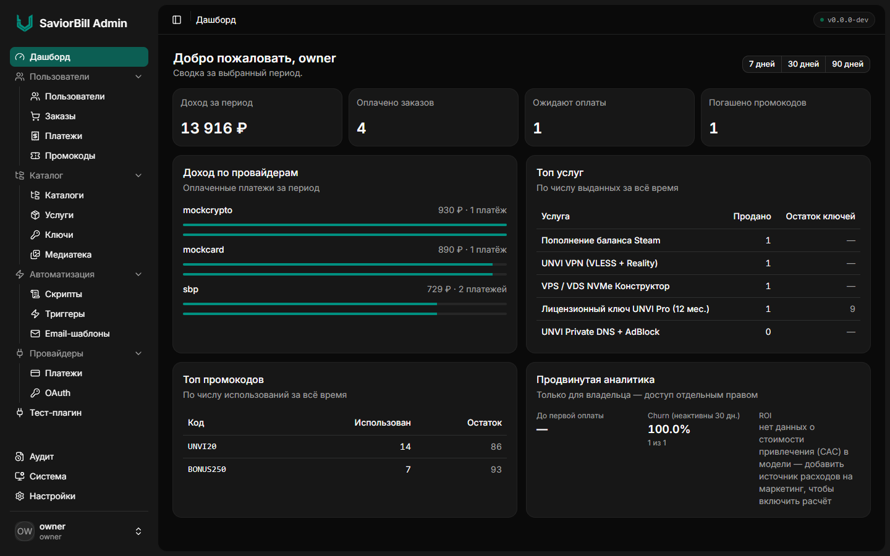
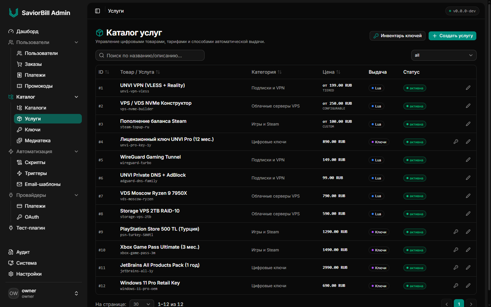
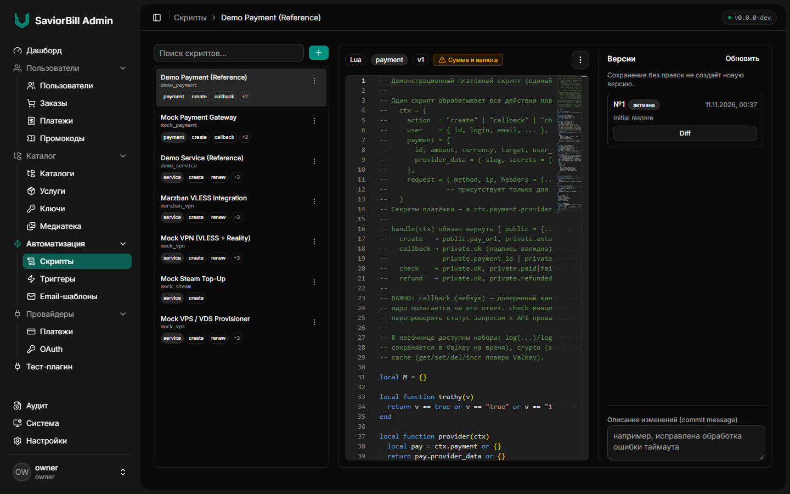
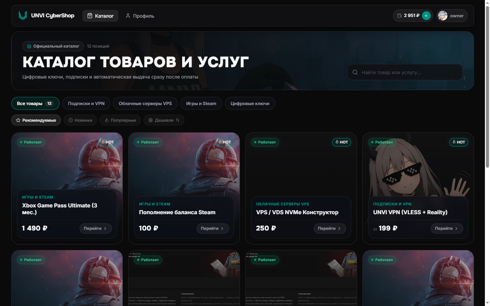
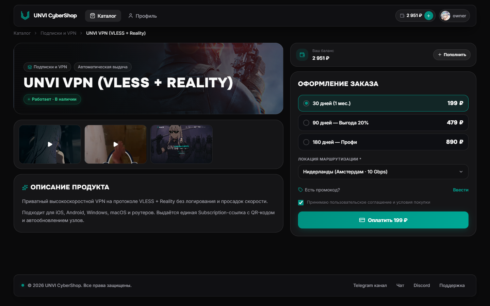

# SaviorBill

**SaviorBill** — событийно-ориентированная self-hosted платформа биллинга и движок магазина цифровых товаров и услуг: мультивалютный баланс, каталоги услуг, гибкие тарифные модели, пулы цифровых ключей, промокоды, интеграция внешних платёжных провайдеров, OAuth/OIDC, email-триггеры, система плагинов и изолированный медиа-конвейер. Бизнес-логика выдачи услуг и обработки платежей исполняется в изолированной песочнице Lua.

---

## Интерфейс

### Панель администратора (`Admin UI`)

| Дашборд аналитики | Каталог услуг и тарифов |
| :---: | :---: |
|  |  |



### Витрина покупателя (`SBPersonalAccountClient`)

| Каталог и фильтрация | Карточка товара, медиагалерея и тарифы |
| :---: | :---: |
|  |  |

---

## Архитектура и стек

- **Backend (`src/`):** Python 3.12 · FastAPI · SQLAlchemy 2 (`asyncpg`) · PostgreSQL 16 · Alembic
- **Admin UI (`adminui/`):** React 19 · TypeScript · Vite · Tailwind CSS · Monaco Editor · Radix UI · `sbuiSDK`
- **Клиентский кабинет:** отдельный репозиторий [SBPersonalAccountClient](https://github.com/UNVISLATE/SBPersonalAccountClient) (может разворачиваться вместе с биллингом через `setup.sh`)
- **Сервисная шина и кэш:** Valkey 8 (`lua:*`, `media:*`, `tasklog:*`), двухуровневый кэш каталога (L1/L2)
- **Песочница логики (`luaworker/`):** изолированный LuaJIT-воркер для сценариев выдачи/продления услуг и платёжных шлюзов
- **Медиа-конвейер (`mediaworker/`):** FastAPI + FFmpeg (конвертация в WebP/WebM, превью, локальная ФС или S3 / Cloudflare R2 / MinIO)
- **Безопасность:** RS256 JWT, Argon2id, шифрование секретов (`Fernet`), `BUS_SIGNING_KEY` (HMAC-SHA256), CSRF-защита, Scoped App Tokens, 404-бан сканеров и журнал аудита

---

## Основные возможности

- **Каталог и биллинг услуг:** иерархические категории, цены `fixed`, `custom` (свободная сумма в заданных пределах), `tiered` (тарифная сетка с длительностями) и `configurable` (конструктор ресурсов с пересчётом цены), выдача из пулов ключей (`SKIP LOCKED`) или через Lua-воркер.
- **Песочница Lua и версионирование:** встроенный редактор с историей версий и diff прямо в админ-панели; хуки `create`, `renew`, `freeze`, `unfreeze`, `delete`, а также вебхуки и фоновая сверка оплат.
- **Server-Driven UI (`sbuiSDK`):** Lua-сервисы и плагины возвращают декларативные JSON-манифесты, которые автоматически рендерятся в интерфейсе покупателя (векторные QR-коды, поля копирования, формы, бейджи и инструкции в Markdown) без пересборки фронтенда.
- **Платежи и FX-движок:** подключаемые Lua-провайдеры платежей с шифрованными секретами, фоновый `BillingLoop` для допроверки зависших транзакций, мультивалютные счета и курсы валют (CBR, MOEX, криптоисточники и кастомные Lua-источники).
- **Промокоды и триггеры:** промо-кампании (скидки и бонусы на баланс), условия активации и лимиты, триггеры `событие -> действие` (email-шаблоны и запуск Lua).
- **Система плагинов и брендирование:** изолированные серверные плагины со своими миграциями и маршрутами, а также настройка темы, логотипа, ассетов и ссылок для клиентской витрины из админки.

---

## Быстрое развёртывание

Подробная документация по продакшн-конфигурации и Multi-Node топологии находится в [**DEPLOY.md**](./DEPLOY.md).

### Установка одной командой

```bash
mkdir ~/saviorbill && cd ~/saviorbill
bash <(curl -fsSL https://raw.githubusercontent.com/UNVISLATE/SaviorBill/master/deploy/setup.sh)
```

Скрипт `deploy/setup.sh`:
1. Проверит и при необходимости установит Docker / Docker Compose.
2. Скачает `docker-compose.yml`, `Caddyfile` и шаблон `.env`.
3. Предложит выбрать клиентскую витрину (`0` — без витрины, `1` — установить [SBPersonalAccountClient](https://github.com/UNVISLATE/SBPersonalAccountClient)).
4. Откроет `.env` для настройки домена, паролей и учётной записи владельца, после чего поднимет стек (`docker compose pull && docker compose up -d`).

После запуска будут доступны:
- **Admin UI:** `https://<DOMAIN>/`
- **REST API:** `https://<DOMAIN>/api/v1/`
- **OpenAPI / ReDoc (billing):** `https://<DOMAIN>/docs` и `https://<DOMAIN>/redoc`
- **Медиа-сервер:** `https://<MEDIA_DOMAIN>/` (и OpenAPI по пути `/docs`)
- **Личный кабинет покупателя:** на домене клиентской витрины (если выбран при установке)

---

## Локальная разработка

В репозитории используется git-сабмодуль `vendor/sbuiSDK`. Клонируйте с флагом `--recurse-submodules`:

```bash
git clone --recurse-submodules https://github.com/UNVISLATE/SaviorBill.git
cd SaviorBill
docker compose -f deploy/dev/docker-compose.yml up -d
```

Отдельный запуск dev-сервера `Admin UI`:

```bash
cd adminui
npm ci
npm run dev
```

Unit-тесты backend:

```bash
pytest -c deploy/test/pytest.ini -m unit
```

---

## Секреты и безопасность

Управление секретами реализовано в `src/security/sec/secrets/`. При первом запуске ключевая пара RS256 (`JWT_PRIVATE_KEY` / `JWT_PUBLIC_KEY`) и ключ шифрования (`SECRETS_KEY`) автоматически создаются в `data-private/` (`chmod 700`), который монтируется исключительно в сервис `billing`.

Поддерживаемые бэкенды (`SECRETS_BACKEND`):
- `file` *(по умолчанию)* — локальные файлы в защищённом каталоге;
- `vault` — HashiCorp Vault (KV v2);
- `aws` — AWS Secrets Manager;
- `gcp` — Google Secret Manager;
- `azure` — Azure Key Vault.

---

## Лицензия

Проект распространяется по модели Source-Available под лицензией **PolyForm Shield License 1.0.0** — подробные условия приведены в [`LICENSE.txt`](./LICENSE.txt).

Вы можете **бесплатно** разворачивать, настраивать и дорабатывать SaviorBill на собственных серверах (self-hosted или private cloud) для приёма платежей и продажи товаров и услуг ваших собственных проектов и бизнеса. Лицензия охватывает использование для собственных нужд без комиссий и роялти; предоставление платформы третьим лицам как конкурирующего продукта или сервиса регулируется ограничениями в [`LICENSE.txt`](./LICENSE.txt).

Copyright © 2026 UNVI &lt;unvidev@ya.ru&gt; · <https://unvi.xyz>
